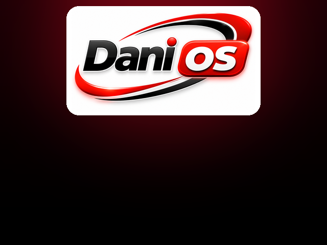
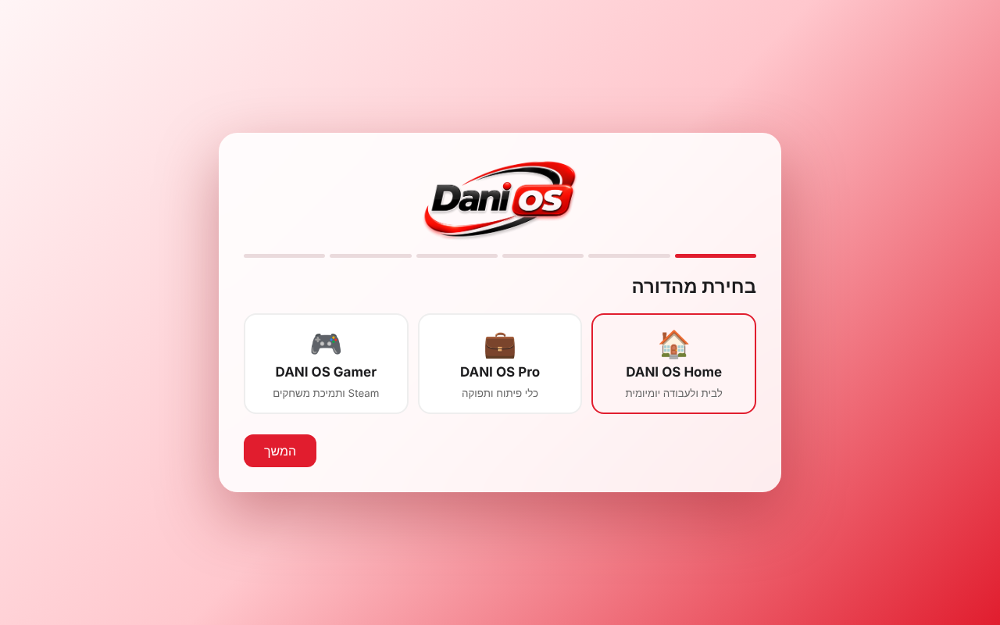
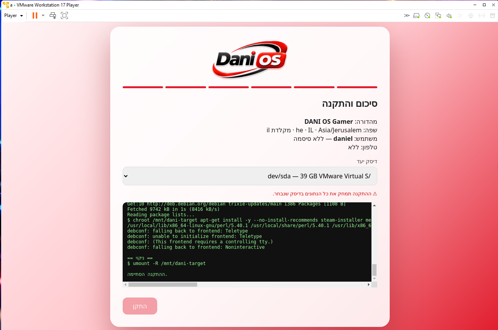
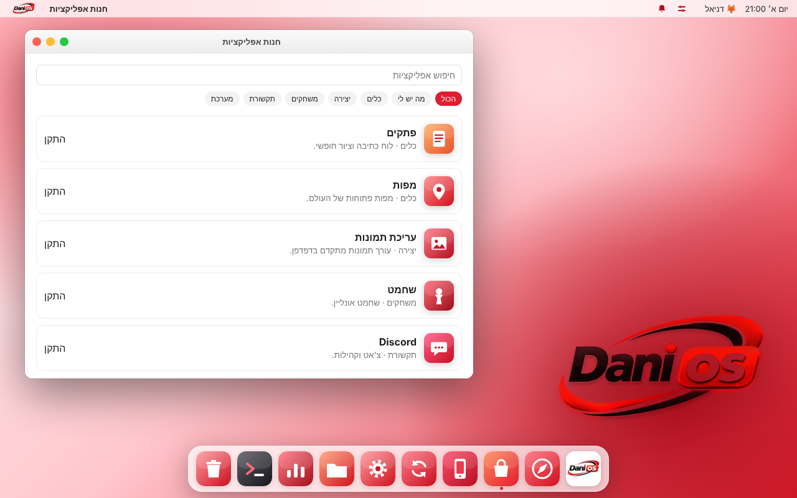
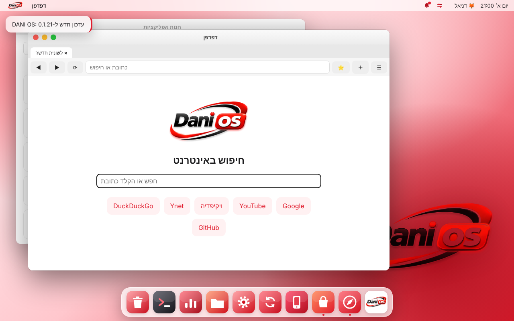
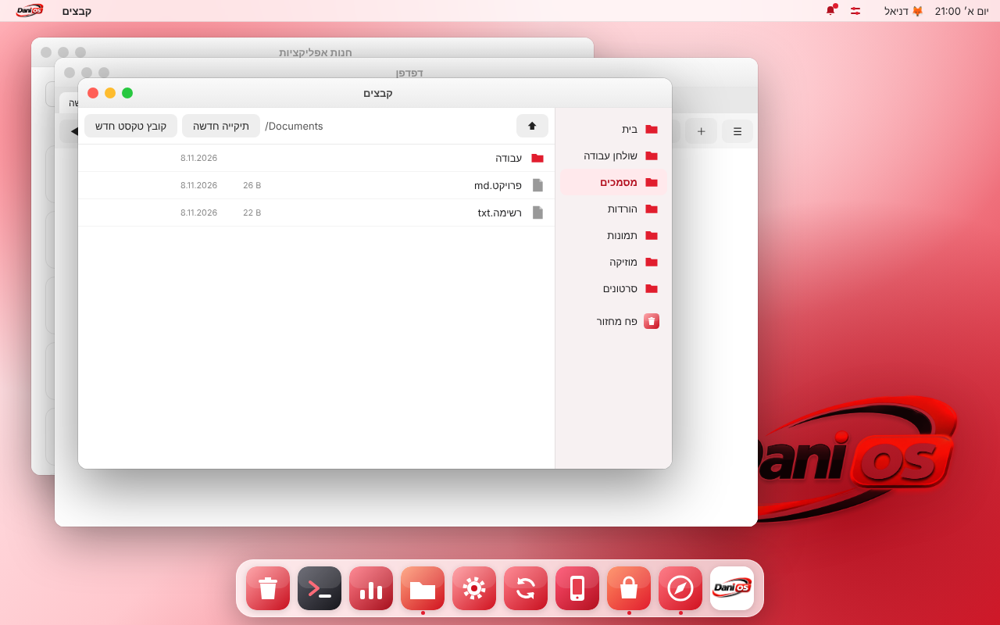
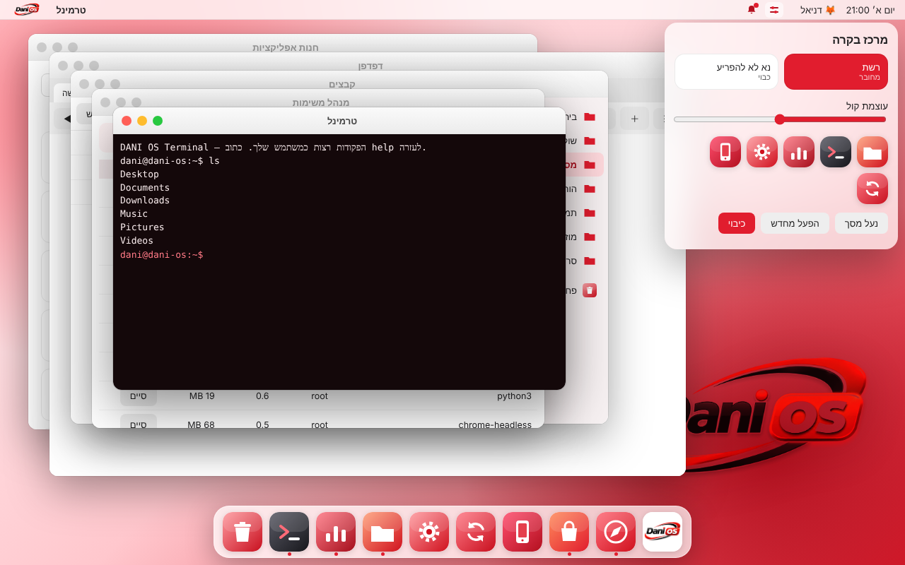
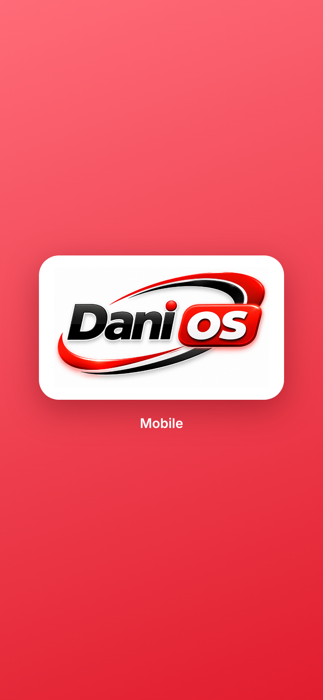
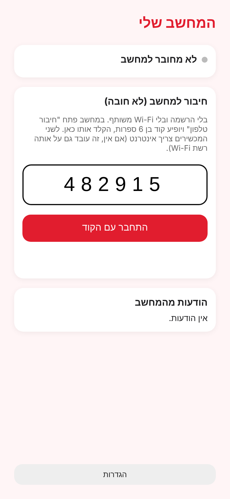
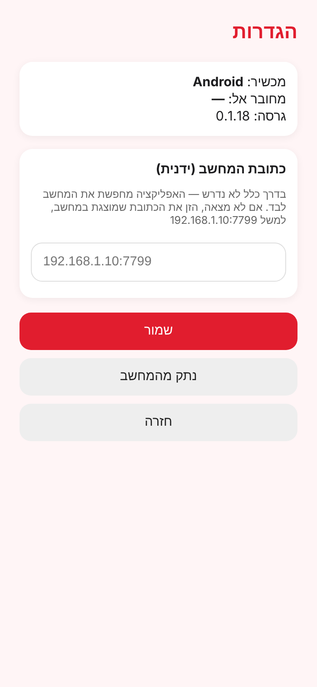

# DANI OS

מערכת הפעלה על בסיס Debian 13 עם מעטפת מקורית בסגנון macOS (אדום-לבן), בלי שולחן עבודה של Linux גלוי, ואפליקציית Android מצורפת (DANI OS Mobile).

**הורדה:** [Releases](../../releases) – בכל גרסה שני קבצים: `dani-os-build-N.iso` (למחשב) ו-`dani-os-build-N.apk` (לטלפון), ו-`.sha256` לבדיקת תקינות.

> **על התמונות:** התמונה `iso-installer-vmware.png` צולמה ב-VMware מ-ISO אמיתי. שאר התמונות מוצגות מהקוד האמיתי של המעטפת, האפליקציה והמתקין בדפדפן (הדמיה של מה שרואים), לא מצילום של מכונה רצה. `boot-splash-preview.png` הוא הרכבה של קבצי מסך הפתיחה, לא צילום מסך.

---

## איך ה-ISO נראה

### 1. תפריט האתחול והפתיחה
| תפריט האתחול (GRUB) | מסך הפתיחה (לוגו אדום-לבן) |
|---|---|
|  |  |

ההפעלה שקטה: בלי הודעות מערכת. אחרי המסך נטען אוטומטית מסך ההתקנה, בלי ללחוץ Enter.

### 2. מסך ההתקנה (6 שלבים: מהדורה, שפה, מדינה/אזור זמן/מקלדת, משתמש, טלפון, סיכום)
| שלב 1 – בחירת מהדורה | סיכום והתקנה (צילום אמיתי מ-VMware) |
|---|---|
|  |  |

- מהדורות: **Home**, **Pro**, **Gamer**.
- אימייל וסיסמה לא חובה. אפשר לדלג על המשתמש וליצור אותו בהפעלה הראשונה, כמו ב-Mac.
- חיבור טלפון לא חובה, ובלי חשבון: רק קוד.
- אחרי ההתקנה מופיע מסך "ההתקנה הושלמה" והמחשב עולה מחדש לתוך DANI OS. אם חוזר מסך ההתקנה, מנתקים את ה-ISO מהמכונה הווירטואלית.

### 3. שולחן העבודה
| חנות אפליקציות | דפדפן |
|---|---|
|  |  |

| קבצים ופח מחזור | מרכז בקרה, מנהל משימות וטרמינל |
|---|---|
|  |  |

מה יש בשולחן העבודה: חנות אפליקציות (חיפוש, קטגוריות, התקנה/הסרה/עדכון, כפתור "מה יש לי"), דפדפן (לשוניות, מועדפים, היסטוריה, דף בית), קבצים עם פח מחזור, מנהל משימות, טרמינל, מרכז בקרה (עוצמת קול, נא לא להפריע, נעילה, כיבוי), מרכז התראות, עדכונים, חיבור טלפון והגדרות.

---

## איך אפליקציית הטלפון נראית

| פתיחה | חיבור עם קוד | הגדרות |
|---|---|---|
|  |  |  |

### חיבור הטלפון למחשב – רק עם קוד
1. במחשב פותחים **חיבור טלפון** ומקבלים קוד בן 6 ספרות (תקף 120 שניות, חד-פעמי).
2. בטלפון מקלידים את הקוד.
3. מאשרים גם במחשב וגם בטלפון.

- **בלי Wi-Fi משותף:** המכשירים מדברים דרך תיבת דואר ציבורית בחינם ([ntfy.sh](https://ntfy.sh)), בלי חשבון. התוכן מוצפן (ECDH P-256 + AES-256-GCM). לשני המכשירים צריך אינטרנט. כך זה עובד גם מתוך VMware.
- **גיבוי:** אם אין אינטרנט, החיבור עובד על אותה רשת Wi-Fi.
- אפשר להפנות לשרת ntfy משלך עם `DANI_RELAY` במחשב.
- הבדיקה האוטומטית: `node Shared/test-relay.js` (מול תיבת דואר מדומה) ו-`node Shared/test-pairing.js`.

---

## איך מתקינים ב-VMware / VirtualBox

1. מורידים את `dani-os-build-N.iso` מה-[Releases](../../releases).
2. יוצרים מכונה חדשה: **דיסק 20 GB לפחות** (ל-Gamer 40 GB), **זיכרון 4 GB**, 2 מעבדים.
3. מחברים את ה-ISO ל-CD/DVD ומפעילים. מסך ההתקנה נפתח לבד.
4. בסוף ההתקנה המחשב עולה מחדש. אם חוזר מסך ההתקנה: Settings, CD/DVD, ביטול החיבור של ה-ISO.

ההתקנה מוחקת את הדיסק שנבחר ב**מכונה הווירטואלית** בלבד. לא מתקינים על דיסק אמיתי בלי לגבות.

## בנייה

- `Build-Scripts/build-iso.sh` – בונה את ה-ISO (live-build, Debian 13). `Build-Scripts/build-apk.sh` – בונה את ה-APK.
- GitHub Actions (`.github/workflows/build-iso.yml`) בונה ISO + APK ומפרסם Release בשם `build-N`.
- כל החבילות מותקנות בתוך סביבת הבנייה, שום דבר לא נוגע בדיסקים של המחשב.

## מבנה הפרויקט

`Computer-OS` (מעטפת + שירות מערכת) · `Installer` (מתקין) · `Mobile-App` (אפליקציית Android) · `Shared` (חיבור טלפון, קטלוג חנות, עדכונים, מיתוג) · `Build-Scripts` · `Windows-Setup` · `Documentation`

## מצב אמיתי

| רכיב | מצב |
|---|---|
| ISO ומתקין | נבנה ב-GitHub Actions. עולה עד מסך ההתקנה והתקנה הסתיימה ב-VMware. התקנה → אתחול מהדיסק → שולחן עבודה עדיין לא אושר בצילום |
| מעטפת (חנות, דפדפן, קבצים, טרמינל, מרכז בקרה והתראות) | נבדקה בדפדפן מול שירות המערכת. לא ראיתי אותה על ISO שרץ |
| חיבור טלפון עם קוד, בלי Wi-Fi | נבדק בבדיקה אוטומטית מקצה לקצה מול תיבת דואר מדומה. עדיין לא נבדק מול ntfy.sh האמיתי ומכשיר Android אמיתי |
| אפליקציית Android | נבנית ב-CI. נבדקה כאן רק בדפדפן, לא על מכשיר |
| נגן סרטונים ומוזיקה, גלריה, ווידג'טים, ערכות עיצוב, העברת קבצים עם הטלפון, DANI AI | **עוד לא נבנו** (מתוכננים לשלבים הבאים) |
