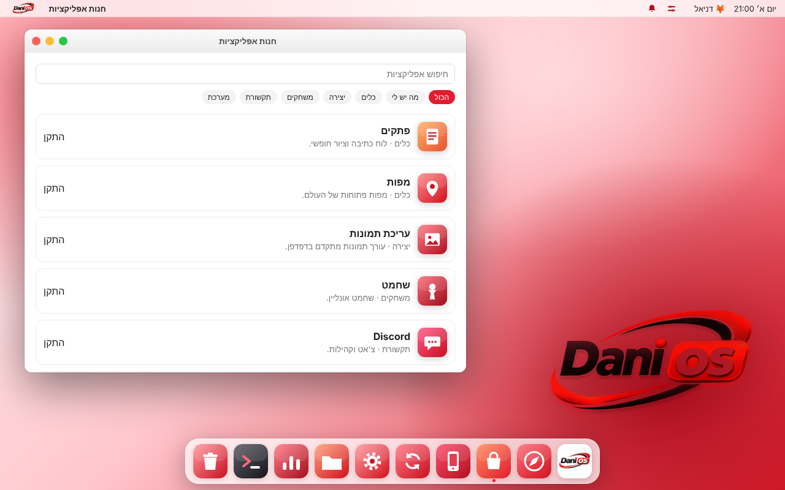
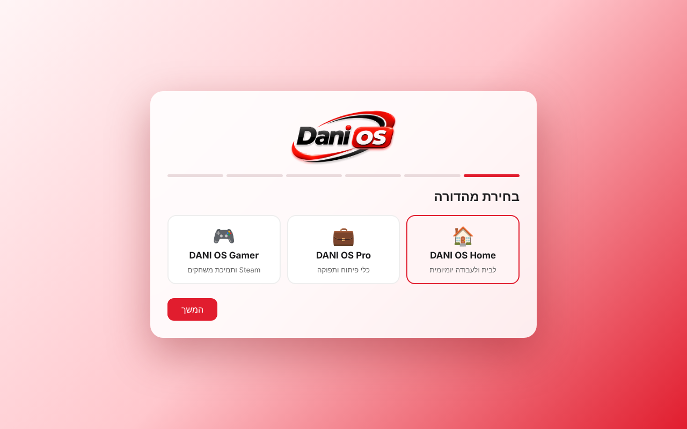
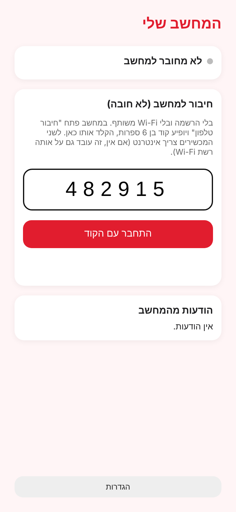

# DANI OS

מערכת הפעלה על בסיס Debian 13 עם מעטפת בסגנון macOS (אדום-לבן) ואפליקציית Android מצורפת.

| ISO – מסך פתיחה | ISO – מתקין | טלפון – חיבור עם קוד |
|---|---|---|
|  |  |  |

- **הורדה:** [Releases](../../releases) – `dani-os-build-N.iso` (מחשב) ו-`dani-os-build-N.apk` (טלפון).
- **תיעוד מלא, איך מתקינים וכל התמונות:** [Documentation/README.md](Documentation/README.md)
